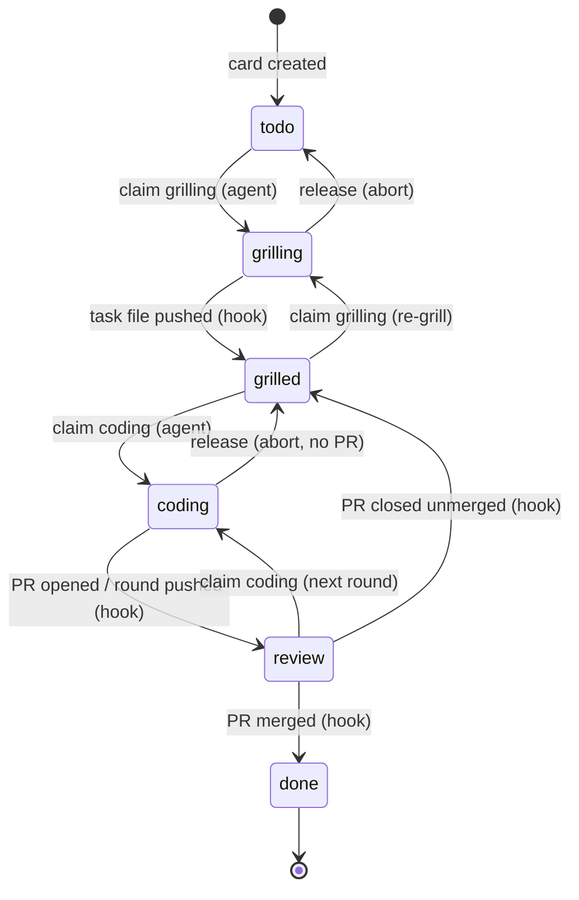

# whackagent on Plane

How the Plane backlog provider (`backlog.provider: plane`) plugs into the whole whackagent workflow: what you install, what lives where, who moves a ticket from one state to the next, and what each command does on Plane.

The Plane provider keeps the board in a project on your own **Plane Community Edition** server, while code, branches, claims and pull requests stay on GitHub. It is the GitHub provider with the board swapped out: the same claims, the same agent rounds, the same PRs, the same `BOARD.md` contract, the same six states. Only where the cards live changes. Plane CE is free and self-hosted, so board traffic costs no GitHub API calls, and the hooks run on your own runner, so no Actions minutes are billed.

> **Experimental.** The whole loop works and was tested end to end on a real Plane server and repository, but it has seen far less use than the GitHub board. Report what breaks.

This guide assumes you know the GitHub flow; [GITHUB.md](GITHUB.md) explains the parts both boards share (agent rounds, PR bodies, stacked PRs, squash merges and the ticket range) in more depth. For the script-level details (every verb's Plane mapping, the hooks, the verified Plane API behavior), see [`providers/plane/README.md`](providers/plane/README.md).

## The one rule

**Agents take tickets. The repo moves them.**

An agent only *claims* a ticket (a lock) before working on it, and releases it if it stops. Every other state change comes from something that really happened in the GitHub repository (a spec pushed, a PR opened, a PR merged) and is applied to the Plane card by the board hooks. Humans use Plane to read the board, write tickets and reorder priorities, never to move a card between columns.

## What lives where

| Thing | Where |
| --- | --- |
| Ticket | a Plane **work item**. Its key is the ticket id (`WA-42`), written as is everywhere: never `#WA-42`, never a bare `42`. Every card is a ticket unless labeled `wa-ignore` |
| Title, summary | the work item's name, first line of its description |
| State | the card's column: Todo, Grilling, Grilled, Coding, Review, Done, plus Canceled |
| Priority | card order on the board (top = next) |
| Size | none: Plane CE cannot create estimates over its API |
| Sprint | a parent card labeled `wa-sprint`, its tickets as children, mirrored by a **cycle** of the same name |
| Milestone | a Plane **module** |
| Dependencies | Plane **relations** ("blocked by") |
| Spec | the task file `{tasks}/WA-42-<slug>.md`, **on the ticket branch**, merged with the code |
| Ticket branch | `wa/WA-42-<slug>` on GitHub |
| Change | one PR per ticket on GitHub, its body carrying the card link |
| Lock | a git ref `refs/wa-claims/WA-42/<phase>` on the GitHub repository |
| Reservation | card **assignees**: assigned to another Plane user = no agent of yours may claim it |

The machinery:

- **`wa-backlog`**: the same Python script as for a GitHub board (stdlib plus `gh`), with a Plane adapter behind the same verbs. Skills call it for every board read or write; a copy is vendored at `.github/board/wa-backlog` so other agents and the hooks run the same commands.
- **`whackagent-board-plane.yml`**: the hooks caller in the project's `.github/workflows/`. It runs whackagent's reusable workflow `rlatapy-luna/whackagent/.github/workflows/board-plane.yml@hooks-v2` on your runner, which runs `wa-backlog hook` from the vendored copy on the default branch (never from the pushed branch, so a ticket branch can't change the code holding the API key). A hook fix therefore reaches the project with a refreshed copy of the script: `/wa-setup` offers that PR when the copy falls behind the plugin.
- **A self-hosted runner** next to the Plane server, which runs those hooks.
- **Repository variables** written by setup (`WA_PLANE_URL`, `WA_PLANE_WORKSPACE`, `WA_PLANE_PROJECT_ID`, `WA_PLANE_STATES`, `WA_RUNNER_LABEL`, plus the shared `WA_BRANCH_PREFIX`, `WA_TASKS_PATH` and friends), the **`PLANE_API_KEY`** environment variable on each machine running agents, and the **`WA_PLANE_API_KEY`** Actions secret for the hooks.

## What you need

- A host with Docker and Docker Compose v2 for Plane CE. Measured idle: 12 containers plus a one-shot migrator, about 4.6 GB of images, about 80 MB of volumes when fresh, under 1 % CPU per container. RAM was about 2.3 GiB on an 18-core machine, more than half of it the Celery worker, which starts one process per CPU; on a 2 to 4 core server expect about 1.2 to 1.5 GiB.
- A machine for the self-hosted runner that reaches the Plane server and GitHub (the Plane host itself is fine): about 440 MB of disk and 110 MiB of RAM, with `python3` and `gh` installed.
- A GitHub repository with `gh` logged in on each developer machine, as for the GitHub board.

## 1. Install Plane

Follow Plane's own self-hosting guide for Docker Compose ([developers.plane.so → Self-hosting](https://developers.plane.so/self-hosting/methods/docker-compose)). Then, before you use it with whackagent:

- **Pin the release.** The provider was built and checked against **v1.4.2** (`APP_RELEASE=v1.4.2` in `plane.env`). A newer release probably works, but nothing guarantees Plane keeps the API behavior the adapter relies on; the facts are listed in [`providers/plane/README.md` → Verified API facts](providers/plane/README.md#verified-api-facts). Upgrade on purpose, not through a floating `stable` tag.
- **Fix the storage image.** The upstream v1.4.2 compose uses `minio/minio:latest`, which no longer pulls (the Docker Hub organization is gone). Replace the `plane-minio` image with `docker.io/pgsty/silo`, the switch Plane itself made after 1.4.2 (makeplane/plane#9962).
- **Lift the API rate limit.** Plane throttles each API key to 60 requests per minute by default, and every board read is several calls. The throttle has no off switch, so set a huge rate instead, in `plane.env`:

  ```sh
  API_KEY_RATE_LIMIT=1000000/second
  ```

  Then **recreate** the `api` container (for example `docker compose up -d --force-recreate api`): the value is read at start-up, and a plain restart keeps the old one. Left at the default, the board still works, but slowly: the script waits out every `429` and retries.
- **Keep Plane's own GitHub integration off.** It would move cards from GitHub events too and fight the hooks. Community Edition ships no GitHub integration, so there is nothing to do there; on a commercial edition, disconnect it under the workspace's *Settings → Integrations → GitHub*. Setup checks this either way.
- **Keep Plane private if you like.** Nothing on GitHub ever calls Plane: the runner polls GitHub over outbound HTTPS and talks to Plane locally. Plane only has to be reachable from the developers' machines and the runner.

## 2. Workspace, project and API key

1. Sign in to Plane, create a workspace (its slug is in the URL: `https://plane.example.com/<workspace>/`) and a project. The project's identifier becomes the ticket key prefix (`WA` gives `WA-42`). Setup adopts this project; it never creates one, and one Plane project serves one repository.
2. Create an API token in Plane (*API tokens* in your settings). Claims assign the Plane user who owns the key, so each developer uses a key of their own account: that way a card claimed by your agents is reserved for you, as on GitHub.
3. On every machine running agents, export it in your shell profile or secret manager, never in the repository:

   ```sh
   export PLANE_API_KEY=<your key>
   ```

4. The hooks need a key as the `WA_PLANE_API_KEY` Actions secret. Their comments on cards appear under the key's user, so a dedicated bot member of the project reads best. Setup asks for it with the key on your clipboard, so it never shows in the chat:

   ```sh
   pbpaste | gh secret set WA_PLANE_API_KEY -R <owner>/<repo>
   ```

## 3. The runner

The hooks are a GitHub Actions workflow that must run where Plane is reachable, so they run on a **self-hosted runner** you operate.

1. In the repository (or its organization): *Settings → Actions → Runners → New self-hosted runner*. GitHub shows the download and configure commands for your OS. Add a label when configuring, for example:

   ```sh
   ./config.sh --url https://github.com/<owner>/<repo> --token <token> --labels whackagent-plane
   ```

2. Pick the label. If every self-hosted runner this repository can use reaches Plane, the default `self-hosted` is enough and nothing else is set. Otherwise use a dedicated label, as above, and setup writes it to the `WA_RUNNER_LABEL` repository variable (`gh variable set WA_RUNNER_LABEL --body whackagent-plane`): a hook landing on a runner that can't reach Plane fails.
3. Make sure `python3` and `gh` are on the runner's PATH. The hooks bring their own GitHub token; `gh` does not need to be logged in. The runner records the PATH when it is configured (the `.path` file in its folder), so after installing either tool later, update that file and restart the runner.
4. Keep it running whenever people push: install it as a service (`./svc.sh install`, then `./svc.sh start`; `sudo` on Linux). While no runner with the label is online, hook runs wait in the queue (up to 24 hours) and the cards wait with them. Nothing is lost: they move once the runner comes back.

On a **public** repository, GitHub advises against self-hosted runners. The workflow never runs pull requests from forks, but pushes to the repository still run on your machine.

## 4. Run `/wa-setup`

In the project, run `/wa-setup` (or `/wa-setup backlog` on a project already set up) and pick the Plane board when asked where the backlog lives. One step at a time, each confirmed:

1. **Where:** Plane URL, workspace slug, project identifier.
2. **Rate limit** and **API key**: the reminders from steps 1 and 2 above.
3. **Single writer:** `wa-backlog check-integration` asks Plane whether its GitHub integration is connected. `off` (always on Community Edition) goes on; `on` stops setup until you disconnect it; `unknown` (another edition, list unreadable) asks you to look in Plane.
4. **Provision:** `wa-backlog provision` adds the missing states (Todo, Grilling, Grilled, Coding, Review, Done, Canceled) in board order with Todo as default, the `wa-ignore` and `wa-sprint` labels, turns on the project's cycles and modules, and writes the repository variables. A column already named otherwise is mapped (`--state grilled="Ready for dev"`), never renamed. Extra columns (Plane's seed `Backlog` and `In Progress`, your team's own) are listed and dropped only if you name them, and only while empty. Running it again changes nothing.
5. **Runner:** the label from step 3 above.
6. **Setup PR** on branch `wa-setup/plane`, never a direct push: `.whackagent/config.md` (`backlog.provider: plane`, `vcs.provider: github`) with the rest of the scaffold, the hooks caller `.github/workflows/whackagent-board-plane.yml`, the board CLI at `.github/board/wa-backlog`, `BOARD.md` rendered with its Plane section, a pointer to it in `AGENTS.md`, `CLAUDE.md` and the Copilot and Cursor instruction files, and the board sections in the PR template. With a branch prefix other than `wa/`, fix the caller's `branches:` filter.
7. **Smoke test** (optional): a throwaway card is created and read back in Todo; you delete it in Plane.

The hooks are live once the setup PR is merged and the runner is online. Ticket branches forked before the merge carry no caller, so their pushes trigger nothing until rebased onto the base.

`/wa-setup` run again later checks that the caller, `BOARD.md` and the vendored CLI match the plugin, re-runs the integration check, and offers one PR refreshing the board files when they fall behind.

## 5. A ticket's life

Same states as on GitHub; only the board writes go to Plane.



**`/wa-task`** creates a card at the bottom of Todo, in the highest open module, with your idea or spec excerpt as its description. Dependencies become relations. No claim, no branch, no task file yet. Reordering the board is yours: drag cards in Plane, or let `/wa-task` with no argument propose an order and apply it on your yes (`wa-backlog move` writes exactly what a drag would). Canceling moves the card to Canceled, on your yes.

**`/wa-grill WA-42`**

1. `claim WA-42 grilling`: the card moves to Grilling, is assigned to the Plane user owning your API key, and gets a `🔒 grilling` comment. Six agents claiming at once: exactly one wins, the others get exit 3 and move on.
2. Creates the ticket branch from its fork point and pushes it right away: `git switch -c wa/WA-42-login-apple origin/main`, `git push -u origin wa/WA-42-login-apple`. There is no GitHub issue to link the branch to: its name ties it to the card.
3. Grills you and writes `{tasks}/WA-42-login-apple.md` (`issue: WA-42`) with non-empty acceptance criteria.
4. Commits it (`task: grill WA-42 login-apple`) and pushes, once, at the end.
5. The hook finds the task file at the pushed commit, moves the card to Grilled, drops the grilling claim and comments `✅ grilled` with a permalink to the spec. The skill waits for that move (seconds with the runner online) and tells you if it doesn't come.

Only that task file counts as a spec. **Acceptance criteria written in the card description do not move the card:** the hooks run on GitHub events and never see a Plane edit.

**`/wa-code WA-42`** claims `coding` (a Grilled card whose blocker is still open is refused unless you say yes), checks out the ticket branch and runs the normal pipeline. The round ends with a commit, a push and a **draft PR** whose body names the card under `## Ticket` with its link, never `Closes`:

```markdown
## Ticket
[WA-42](https://plane.example.com/acme/browse/WA-42/)
```

The hook moves the card to Review, drops the coding claim, comments `🔀 review`, and adds the PR to the card as a link (`#7 Login with Apple`). A PR from a branch not named after the ticket (a cloud agent's, say) still links up through that one card link in its body; a body with two card links moves nothing and gets a comment on the PR.

**`/wa-feedback WA-42 <notes>`** claims `coding` from Review, takes your notes plus the PR's review comments, and pushes. The hook ends the round: Review again, claim dropped, a `🔀 review — round <sha> pushed` comment on the card and a `📝 feedback` comment on the PR, both linking the new `## Feedback` round of the task file. Each PR comment taken gets its reply, as on GitHub.

**`/wa-validate WA-42`** claims `coding`, runs the project tools and the verifier over the whole diff, autofixes, and on a clean verdict syncs the wiki, rebases when the base moved, pushes and marks the PR ready. The card stays in Review; the hook comments `✅ ready`. Draft = your turn to test, ready = your turn to merge.

**`/wa-close WA-42`** checks the PR can merge, shows the plan, and on your yes merges it (squash, never `--admin`). Merging on GitHub yourself is just as good. Either way the hook moves the card to Done, drops the claims and posts the PR's run report on the card as a `🎉 done` comment. A PR closed without merging sends the card back to Grilled (`↩️ grilled`), unless a coding claim is held or another PR for it is still open.

**`/wa-autopilot`** works the same as on GitHub: unclaimed Grilled tickets in board order (or a sprint, a module, a list of keys), each claimed just before its wave, delivered as a ready PR when the verifier is clean and a draft when findings remain. **`/wa-board`** and the backlog pane read the Plane board, with the keys as ticket ids.

`/wa-board` flags a claim with no push for 24 hours (`WA_STALE_AFTER_HOURS`) as stale; only you clear it, with `/wa-task release WA-42`.

## Sprints, milestones, dependencies

- **Sprint** = a parent card labeled `wa-sprint`, whose name in kebab-case is the sprint name, with the tickets as its child cards. A cycle of the same name (without dates, so it never ends) mirrors it, so Plane's cycle view shows the sprint. The parent decides: a card dragged into the cycle by hand, without the parent, is not in the sprint. A grill that splits a ticket makes it the parent and its children the new tickets. Ticket branches fork off `sprint/<name>` and PRs target it, as on GitHub. When the sprint lands (its sprint PR merged, or its last ticket merged when sprints have no branch), the hook moves the parent card to Done with a `🏁 sprint landed` comment. A parent left open with nothing to land is the one card you move by hand: to Done, or to Canceled when nothing shipped.
- **Milestone** = a Plane module, which you create in Plane (no paid Plane feature needed; Plane's Milestones are not used). New tickets join the highest open module in version order of names (`0.10.0` above `0.9.0`), a ticket sits in one module at a time, and `/wa-release` marks the shipped module completed on your yes.
- **Dependencies** = relations ("blocked by"), shown on both cards. A blocker counts as open until its card sits in Done or Canceled. Plane's API can add a relation but not remove one: a dependency added by mistake is removed in the Plane UI.
- **Reservation**: assign a card to yourself in Plane and other developers' agents leave it alone. Plane display names are not unique, so whackagent compares user ids, never names.

## The board check

On weekdays at 06:17 UTC, or by hand with `gh workflow run whackagent-board-plane.yml`, the hooks check the board against the repository. **It only reports; it never moves a card.**

- a card in Grilling or Coding with no claim held
- a claim with nothing new for `WA_STALE_AFTER_HOURS` (default 24)
- a card in Review with no open PR
- an open PR for a card still in Todo or Grilled
- a PR linked on the card merged while the card is not in Done
- a card in Grilled with no ticket branch
- acceptance criteria in the description of a card in Todo

Each problem gets one `⚠️ board check` comment on the card, never posted twice, edited to `✅ board check — resolved` once fixed. The run's job summary lists every problem. Fix the cause (claim, release, open the PR, push the spec), never the symptom by dragging the card.

## Moving from a GitHub board

A project already on a GitHub board moves with `/wa-setup` reconfigure: switch `backlog.provider` from `github` to `plane`.

1. Steps 1 to 5 of the setup above. Provisioning writes the Plane variables beside the GitHub board's; the config stays `github` until the setup PR.
2. **Dry run** (`wa-backlog migrate`): reads both boards and prints the plan without writing anything. It **refuses** while any ticket is in Grilling, Coding or Review or in a column of your own, holds a claim or has an open PR, and names each one: land, release or cancel them, then run it again.
3. **Apply**, on your yes: every Todo and Grilled ticket becomes a card in the same order and state, with its body, its comments (each headed with the original author and date), its sprint (parent plus cycle), its milestone (modules created from your GitHub milestones) and its dependencies. Each ticket branch is rebuilt as one local commit on `wa/<new key>-<slug>` with the task file renamed, and each GitHub issue is closed as not planned with a link to its card and a `wa-moved` label.
4. **Push**, on a second yes: the renamed branches are pushed and the old ones deleted.
5. **Setup PR**: config to `plane`, the GitHub hooks caller swapped for the Plane one, `BOARD.md` and the PR template re-rendered for Plane.

Not copied: size (a Plane board has none), assignees (re-assign in Plane; the report lists them), Done and Canceled tickets (their history stays on GitHub). The GitHub Project is never written: it stays as the archive. A run that stops halfway picks up where it left off when run again, without duplicates. Moved Grilled branches were forked before the setup PR, so their pushes trigger nothing on Plane until rebased onto the base; pull request events work at once.

## Troubleshooting

- **The card didn't move.** The skill that pushed, opened or merged re-reads the card for about three minutes, then looks up the hook run and tells you which case it is:
  - **failed**: open the run's link; the log names the cause. A missing `WA_PLANE_URL` variable or `WA_PLANE_API_KEY` secret fails with a clear message.
  - **queued**: no runner with the `WA_RUNNER_LABEL` label is online. Start it; the run and the card move then.
  - **in progress**: give it a few seconds.
  - **success**, but nothing moved: the run's summary line says why, for example a card in a column whackagent doesn't own.
  - **not triggered**: no run at all. The branch was forked before the caller reached the base (rebase it), the caller's `branches:` filter doesn't match your prefix, or the PR conflicts with its base (GitHub runs no `pull_request` workflow then: rebase).

  The agent never moves the card itself to make up for it. Fix the cause, then push again or re-run the hook (`gh run rerun <id>`).
- **`Plane rate limit hit`**: the server still runs Plane's default 60 requests per minute. The script retries on its own; lift the limit (step 1) to make the board fast again.
- **`PLANE_API_KEY not set`**: export the key in the shell the agent runs in (step 2).
- **A ticket id is refused** (exit 2): use the full key, `WA-42`, not `42` or `#WA-42`.
- **A card moved with no hook run behind it**: a second writer is moving cards, most likely Plane's own GitHub integration. Re-run `wa-backlog check-integration`.
- **A card sits in a column outside the seven states** (a team column such as `Blocked`): agents never claim it and the hooks leave it alone, except that a held coding claim makes the next PR hook take it back. While it sits there, it is a human's card.

## Not built yet

- Moving a card to Grilled from a spec in the card description (it would need a webhook relay from Plane).
- Size.
- Moving a local file backlog to Plane, or a Plane board back to GitHub.
