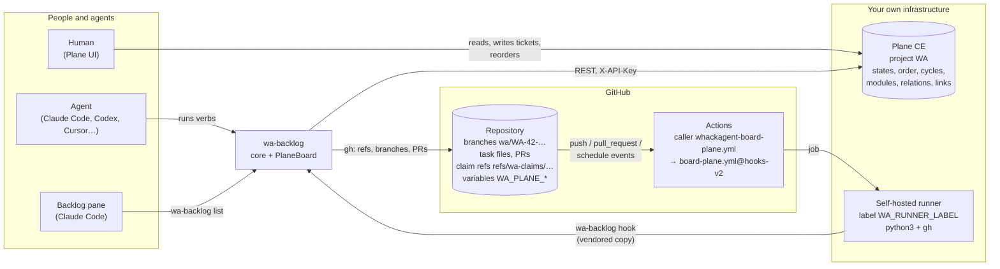
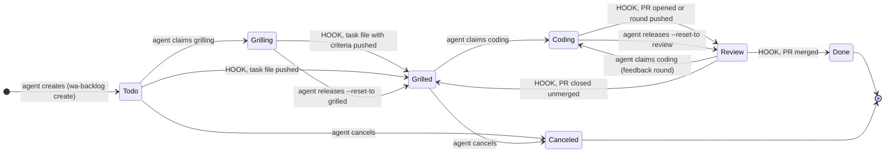
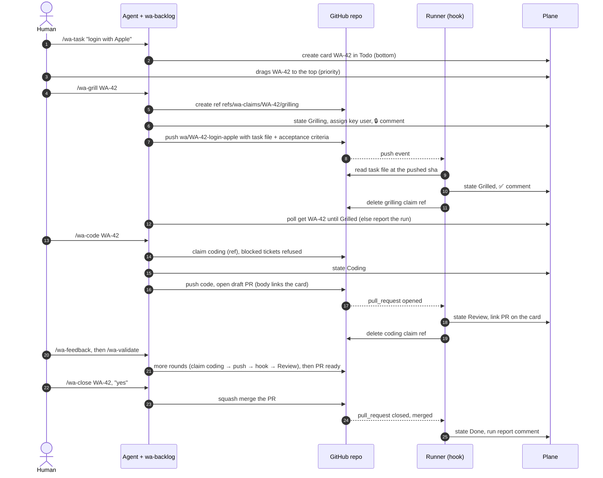
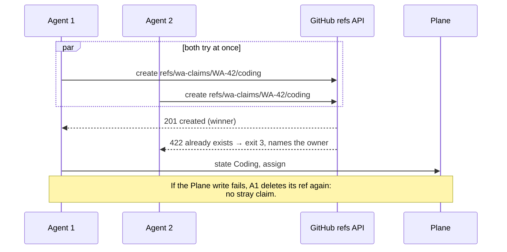
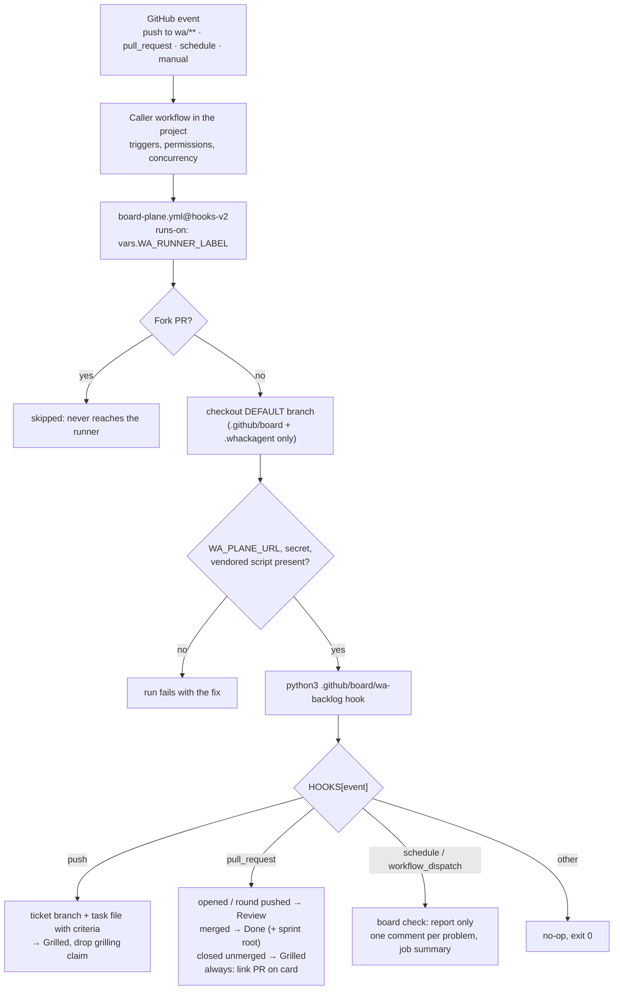
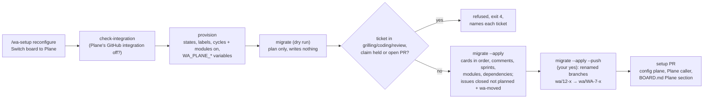

# How the Plane board works

This page explains the pieces of the Plane board provider and how events flow between them. It describes how the system is built and why. For the setup steps, read [PLANE.md](../PLANE.md). For the rules every agent follows, read the project's `BOARD.md`.

In one sentence: **Plane holds the board, GitHub holds the code, and two writers move cards: agents through `wa-backlog`, and hooks running on a self-hosted runner.** Humans read the board, write tickets and reorder priorities in Plane. They never drag a card to another column.

## The pieces

| Piece | What it is | Where it lives |
|---|---|---|
| **Plane CE** | The board: one project whose states are the six board states plus Canceled. Card order is priority, a cycle is a sprint, a module is a milestone, a relation is "blocked by", and a link points to the PR. | Your server. Free and open source. The per-key API limit must be lifted (`API_KEY_RATE_LIMIT=1000000/second`). |
| **`wa-backlog`** | One Python script (stdlib only). Its core handles the CLI, verbs, claims, PRs, merges and hooks. A `Board` interface sits on top, with one adapter per board tool: `GitHubBoard` and `PlaneBoard`. | `providers/wa-backlog` in the plugin. Each project vendors a copy at `.github/board/wa-backlog`. |
| **GitHub repository** | Code, ticket branches, task files (the spec), pull requests, and **claims** (atomic git refs). Settings live in repository variables. | GitHub, unchanged from the GitHub provider. |
| **Caller workflow** | A short file in the project that holds the triggers, permissions and concurrency. | `.github/workflows/whackagent-board.yml`, installed by `/wa-setup` from `providers/plane/whackagent-board-plane.yml`. |
| **Reusable workflow** | Checks out the default branch, then runs `wa-backlog hook` with the Plane key. | `rlatapy-luna/whackagent/.github/workflows/board-plane.yml@hooks-v2`. |
| **Self-hosted runner** | Runs the hook jobs next to Plane, so Plane stays on a private network and no Actions minutes are billed. | A machine you own that can reach `WA_PLANE_URL`. |
| **Backlog pane** | The board drawn beside the chat in Claude Code. | `hooks/` in the plugin. It reads `wa-backlog list`. |

## Who moves a card

The PRD's single-writer rule: every state change comes from an agent claim or from a hook, never from a human drag. Plane's own GitHub integration must stay off (`wa-backlog check-integration`).

- **Agents** only ever write `grilling` and `coding`, always through an atomic claim, plus `cancel`.
- **Hooks** write `grilled`, `review` and `done`, from what happened in the repository.
- **Humans** reorder cards. Order is priority, and agents pick from the top.

## A ticket's whole life

Two details matter:

- **The spec is the task file on the ticket branch**, not the card description. A spec written in the card description does not move the card to Grilled; the board check reports it as `spec-todo`. Plane webhooks can't reach a runner that only polls GitHub, so this is a v1 limitation.
- **The PR names its ticket** by its branch (`wa/WA-42-…`). If the branch has another name (for example a cloud agent's own branch), exactly one card link in the PR body names the ticket. With two card links, the hook moves nothing and says so on the PR.

## Claims: why they stay on GitHub

A claim is a git ref, `refs/wa-claims/<id>/<phase>`, created through the GitHub REST API. Git refuses to create a ref that already exists, so exactly one agent wins, whatever board tool sits behind it.

- `claims` lists live claims with owner, last activity and a stale flag (no push for `WA_STALE_AFTER_HOURS`, default 24).
- Releasing with `release --reset-to grilled|review` moves the card back and deletes the ref.
- Live test: six parallel claims on one card gave one winner and five exit 3, for both phases.

## The hook pipeline

Why it is built this way:

- **The script runs from the default branch, never from the pushed ref.** A ticket branch can't change the code that holds the Plane API key.
- **The hook logic is the project's vendored script.** Moving `hooks-v2` updates the workflow steps. A fix to the hook logic reaches a project only when `/wa-setup` refreshes `.github/board/wa-backlog`.
- **Settings come in whole.** The workflow passes `toJSON(vars)` as `WA_VARS`, because `GITHUB_TOKEN` can't list repository variables.
- **Every handler is idempotent.** Re-running a job (`gh run rerun`) changes nothing a second time, apart from one extra `✅ ready` comment.
- **Waiting skills never fake a move.** After a push they poll the card for about 3 minutes. If it hasn't moved, they report the run: failed (with its URL), queued (runner offline), in progress, or not triggered.

## The board check

On the schedule (weekdays 06:17 UTC) or on a manual run, the hook compares the board with the repository and only reports.

- **Problems it reports:**
  - a card in Coding or Grilling with no claim;
  - a stale claim;
  - a merged PR whose card is not Done;
  - a card in Review with no PR;
  - an open PR whose card is not in Review;
  - a Grilled card with no ticket branch;
  - criteria found in a Todo card's description.
- **One comment per problem on the card.** It is de-duplicated with Plane's `external_source`/`external_id` fields, and edited in place to `✅ resolved` once the problem is gone.
- **The job summary** lists every problem.
- **It never moves a card.**

## Moving an existing GitHub board to Plane

- **Resumable:** every step checks what it leaves behind (external ids, refs, labels), so a rerun after a failure finishes without duplicates.
- **Not copied:** assignees, size, and done or canceled history. The GitHub Project stays untouched as an archive.

## Limits to know

- **Experimental:** the provider has not run on a real team project yet.
- **No size:** Plane CE v1.4.2 can't create estimates through its API.
- **Relations are add-only:** the API can't remove a "blocked by" relation, so remove it in the Plane UI.
- **Card-description specs don't count:** a spec written in the card description does not move the card. Use the task file.
- **One more machine to run:** a self-hosted runner is required infrastructure.

## Where to read more

- [PLANE.md](../PLANE.md): step-by-step setup and troubleshooting.
- [WORKFLOW.md](../WORKFLOW.md): cheat sheet with GitHub and Plane side by side.
- [providers/plane/README.md](../providers/plane/README.md): verified Plane API facts, settings, mapping, live test evidence.
- [providers/README.md](../providers/README.md): how to add another board tool.
- `templates/BOARD.md`: the board rules every agent follows (*This board: Plane*).
