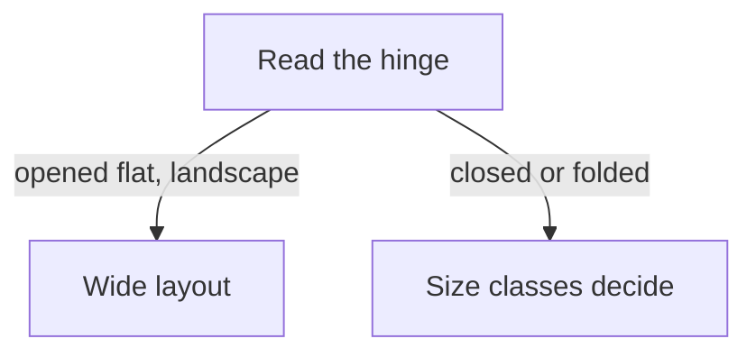

<!-- lb-agents -->
On a foldable iPhone, the keypad spreads to the edges of the screen when no camera is in the way.

<details>
<summary>Overview</summary>
<br>

**Foldable closed, landscape, camera on the left**

1. `HingeStatusChangeModifier` reads the hinge: `.closed`.
2. `HingeRule` lets `SizeClassRule` pick the layout.
3. `SizeClassRule` returns `.unoccludedScreenEdges`.
4. The camera crosses the keypad on the left: that side keeps the safe area.

→ Keypad 14 pt from the right edge, safe area on the left.

</details>

### Changes

<dl><dd><details>
<summary>Add foldable posture detection to pick the keypad layout</summary>
<dl><dd><br>

**Before**: `SizeClassRule` picked the layout from size classes alone.

**Now**: `HingeRule` also reads the hinge posture.
- Opened flat in landscape, the layout is wide.
- Otherwise `HingeRule` lets `SizeClassRule` decide.

```swift
enum HingeStatus { // how far the screen of a foldable iPhone is opened
    case closed         // folded shut, outer screen only
    case partiallyOpen  // half folded along the division
    case fullyOpen      // opened flat
}
```

**Callers**: `LayoutContext` gains `containerAxis`, `hingeStatus` and `divisionAxis`, so every `.init` passes the three.

```diff
- Self.letsUserChooseLayoutMode ? ChosenModeRule(chosenLayoutMode) : SizeClassRule()
+ Self.letsUserChooseLayoutMode ? ChosenModeRule(chosenLayoutMode) : HingeRule()
```

**How the posture reaches the rule**

- `HingeStatusChangeModifier` listens to `onHingeChange` and maps the system status to `HingeStatus`.
- `KeypadLayoutModifier` keeps it in `@State` and rebuilds the `LayoutContext`.



</dd></dl>
</details></dd></dl>

<dl><dd><details>
<summary>Change the keypad sides: 14 pt from the screen edge, except where the camera crosses it</summary>
<dl><dd><br>

**Before**: the keypad stayed within the safe area on both sides.

**Now**: each `LayoutModeRule` says how far the keypad spreads, with a `KeypadEdgeReach`.
- `safeArea`: the keypad stays within the safe area.
- `screenEdges`: the keypad spreads to both sides.
- `unoccludedScreenEdges`: the keypad spreads to each side no occlusion crosses.

**Callers**: `LayoutModeRule` requires `keypadEdgeReach(in:)`, so every rule implements it.

</dd></dl>
</details></dd></dl>

Closes #66

### Acceptance criteria
- [x] Opened flat in landscape, the keypad is wide.
- [ ] Camera side keeps the safe area: not proved on a device yet.

### How to test
1. **Setup**: run the app on a foldable iPhone simulator.
2. **Path**: Launch → Calculator
3. Rotate to landscape, fold closed → the keypad reaches the right edge, the left side keeps the safe area.

Draft — verifier not run yet. Test, then /wa-feedback · /wa-validate.
<!-- /lb-agents -->
